# Local Multi-Region Highly Available Data Platform
> **Self-healing with proof**: An enterprise-grade, multi-region distributed object storage platform with automated disaster recovery, cryptographic failback gating, chaos-as-code resilience, and autonomous GitOps continuous delivery.

<p align="center">
  
</p>

<p align="center">
  <strong>Course Project:</strong> SETU SWFW_5S_02 &nbsp;|&nbsp;
  <strong>Author:</strong> <a href="https://github.com/Abhishek7439">Abhishek Kothe (@Abhishek7439)</a><br>
  <strong>Institution:</strong> YCCE Nagpur (Dept. of Computer Technology) &nbsp;|&nbsp;
  <strong>Academic Term:</strong> 5th Semester (November 2026)<br>
  📄 <strong>Technical Report:</strong> <a href="report/SETU_SWFW_5S_02_Project_Report.pdf"><strong>SETU_SWFW_5S_02_Project_Report.pdf</strong></a> (18-Page Comprehensive Defense Document)
</p>

---

## Table of Contents
- [What Makes This Different?](#what-makes-this-different)
- [System Architecture](#system-architecture)
- [Headline Empirical Results](#headline-empirical-results)
- [How It Works: End-to-End Self-Healing](#how-it-works-end-to-end-self-healing)
- [Quick-Start & Verification](#quick-start--verification)
- [Chaos Engineering Resilience Suite (E1–E5)](#chaos-engineering-resilience-suite-e1e5)
- [Autonomous GitOps Continuous Delivery](#autonomous-gitops-continuous-delivery)
- [Cryptographic Deep Audit](#cryptographic-deep-audit)
- [Honest Limitations & Stated Scope](#honest-limitations--stated-scope)
- [Repository Map](#repository-map)
- [Documentation & Evidence Index](#documentation--evidence-index)

---

## What Makes This Different?

Most educational distributed systems stop at basic load balancing or passive failover. This platform demonstrates:

1. **Measured RTO & RPO, Not Marketing Claims**: Recovery Time Objective (3.4s–4.7s) and Recovery Point Objective (0 missing objects) are measured empirically under real concurrent client write workloads (30–42 req/s) with surviving disks.
2. **Cryptographic Integrity Failback Gate**: Restoring a failed primary without administrative fencing causes split-brain overwrites. Our DR controller forcibly fences the primary into `MAINT` on HAProxy's admin socket, continuously checking metadata parity (1.2s across 140+ objects) and un-fencing only when byte parity is mathematically confirmed.
3. **Chaos Engineering as Code**: A standalone test harness (`make chaos`) validates 5 distinct, falsifiable failure modes: hard crash (SIGKILL), socket freeze (`docker pause`), WAN latency/bandwidth degradation (Toxiproxy), asymmetric one-way network partition with Last-Write-Wins conflict resolution, and mid-deploy failure.
4. **Autonomous GitOps Without Kubernetes**: Pull-based continuous deployment with pre-flight YAML validation (`docker compose config`), targeted container recreation (stateless gateway only), and an active post-apply health gate with automated rollback to `last_good` in 19.0 seconds.
5. **Zero External Python Packages**: Pure Python 3.10+ standard library (`urllib`, `socket`, `hashlib`, `hmac`). AWS Signature Version 4 HMAC-SHA256 signing is implemented natively—no 100+ MB `boto3` or `botocore` dependencies.
6. **Scientific Honesty & Explicit Limitations**: Stated trade-offs: eventual consistency (LWW), surviving-disk assumption, client timeout impact on RTO, and simulated WAN characteristics.

---

## System Architecture

The platform models two geographically separated data centers running locally on standard Linux (WSL2 / Ubuntu):

```mermaid
flowchart TD
    Client["Client / Workload (AWS SigV4 S3 API)"] -->|":8080"| Gateway["HAProxy Gateway (:8080)
Layer-7 Health Checks & Socket Admin (:9999)"]
    
    subgraph RegionA["Region A (Primary - 172.28.10.0/24)"]
        MinioA["MinIO Region A (:9000)
Storage: minio_a_data volume"]
    end

    subgraph RegionB["Region B (Backup - 172.28.20.0/24)"]
        MinioB["MinIO Region B (:9000)
Storage: minio_b_data volume"]
    end

    subgraph Transit["WAN Transit Network (172.28.30.0/24)"]
        Toxi["Toxiproxy WAN Bridge (:8474 / :9002)
Injects Latency, Jitter, Bandwidth, Partitions"]
    end

    Gateway -->|"Primary Path (active)"| MinioA
    Gateway -.->|"Backup Path (standby)"| MinioB
    
    MinioA <===>|"Two-Way Active-Active Replication"| Toxi
    Toxi <===> MinioB

    DR["DR Controller
(Autonomous 5-State FSM)"] -->|"Unix/TCP Socket Fencing"| Gateway
    DR -->|"Active Probing & Verification"| MinioA
    DR -->|"Active Probing & Verification"| MinioB

    GitOps["GitOps Reconciler
(Pull-Based Engine)"] -->|"Poll /tmp/setu-gitops-wt"| Docker["Docker Daemon"]
```



### Core Primitives
* **HAProxy Ingress Gateway (`:8080`)**: Single entry point with active layer-7 health checks (`/minio/health/live`), `inter 1s fall 2 rise 2`, and dynamic runtime socket fencing (`127.0.0.1:9999`) to dynamically disable backends without configuration reloads.
* **Dual Isolated Regions**: `setu_region_a` (`172.28.10.0/24`) and `setu_region_b` (`172.28.20.0/24`) running Chainguard MinIO containers with private named volumes (`minio_a_data`, `minio_b_data`).
* **WAN Transit Network (`172.28.30.0/24`)**: Controlled cross-region bridge routing traffic via Toxiproxy for precise, unprivileged network fault injection.
* **Autonomous DR Controller**: 5-state finite state machine with flapping suppression and metadata parity gating.
* **GitOps Reconciler**: Polls bare git repo every 5s, applies changes to stateless containers only, validates health, and auto-rolls back if degraded.

---

## Headline Empirical Results

Every metric below is extracted directly from runtime execution logs preserved in [`docs/04-test-evidence/`](docs/04-test-evidence/):

| Capability | Scenario / Target | Measured Metric | Status | Primary Evidence File |
|:---|:---|:---:|:---:|:---|
| **Multi-Region Vitality** | AT1: All endpoints HTTP 200 | Region A `:9100`, Region B `:9200`, Gateway `:8080` live | **PASS** | [`docs/04-test-evidence/m0-at1-at2.md`](docs/04-test-evidence/m0-at1-at2.md) |
| **Site Replication** | AT2: Cross-region data sync | Identical SHA-256 (`2cf99d0e...`) across regions | **PASS** | [`docs/04-test-evidence/m0-at1-at2.md`](docs/04-test-evidence/m0-at1-at2.md) |
| **Failover RTO** | AT3: Graceful stop failover | **`3448 ms`** (3s grace window + 443ms write probe) | **PASS** | [`docs/04-test-evidence/m2-controller.md`](docs/04-test-evidence/m2-controller.md) |
| **Integrity Failback** | AT4: Fast metadata gate | Inventory match across 143+ objects in **`1.2s`** (123x speedup) | **PASS** | [`docs/04-test-evidence/m3-failback-rpo.md`](docs/04-test-evidence/m3-failback-rpo.md) |
| **Cryptographic Deep Audit**| Full SHA-256 payload audit | **153 / 153 objects** verified bit-for-bit identical (`sha256_checked: 153`) | **PASS** | [`docs/04-test-evidence/m6-deep-audit.md`](docs/04-test-evidence/m6-deep-audit.md) |
| **RPO (Graceful Stop)** | Sequential write stream | **`0` missing objects** (12/12 acknowledged writes preserved) | **PASS** | [`docs/04-test-evidence/m3-failback-rpo.md`](docs/04-test-evidence/m3-failback-rpo.md) |
| **RPO (SIGKILL Crash)** | Sequential write stream | **`0` missing objects** (12/12 acknowledged writes preserved) | **PASS** | [`docs/04-test-evidence/m3-failback-rpo.md`](docs/04-test-evidence/m3-failback-rpo.md) |
| **GitOps Auto-Apply** | AT5 Phase A: Valid config change | Deployed and verified healthy in **`8.0s – 10.0s`** | **PASS** | [`docs/04-test-evidence/m4-gitops.md`](docs/04-test-evidence/m4-gitops.md) |
| **GitOps Auto-Rollback**| AT5 Phase B: Broken gateway config | Health gate failed; restored to `last_good` in **`19.0s`** | **PASS** | [`docs/04-test-evidence/m4-gitops.md`](docs/04-test-evidence/m4-gitops.md) |
| **Chaos E1 (Crash)** | SIGKILL `minio-a` under 37.2 req/s | Median RTO: **`4732 ms`**; `RPO_failover`: 0; `RPO_after_return`: 0 | **PASS** | [`docs/04-test-evidence/m5-chaos.md`](docs/04-test-evidence/m5-chaos.md) |
| **Chaos E2 (Socket Freeze)**| `docker pause minio-a` (gray failure)| Median RTO: **`7211 ms`**; `RPO_failover`: 0; `RPO_after_return`: 0 | **PASS** | [`docs/04-test-evidence/m5-chaos.md`](docs/04-test-evidence/m5-chaos.md) |
| **Chaos E3 (WAN Degrade)** | 500ms latency + 32KB/s bandwidth | Zero dropped writes; replication lag bounded under 3.5s | **PASS** | [`docs/04-test-evidence/m5-chaos.md`](docs/04-test-evidence/m5-chaos.md) |
| **Chaos E4 (Partition)** | Asymmetric one-way split (A -> B)| Concurrent writes resolved deterministically via LWW | **PASS** | [`docs/04-test-evidence/m5-chaos.md`](docs/04-test-evidence/m5-chaos.md) |
| **Chaos E5 (Deploy Chaos)**| SIGKILL during GitOps apply | Reconciler locked, healed, and restored service in **`12.1s`** | **PASS** | [`docs/04-test-evidence/m5-chaos.md`](docs/04-test-evidence/m5-chaos.md) |

<p align="center">
  
  <br>
  <em>Figure 2: Empirical RTO measurements across 3 sequential runs for hard crash (E1) vs socket freeze (E2). Gray failure RTO includes client timeout windows. Source: docs/04-test-evidence/m5-chaos.md.</em>
</p>

---

## How It Works: End-to-End Self-Healing

The platform executes autonomous detection, fencing, failover, and integrity-checked failback without manual operator intervention:

<p align="center">
  
  <br>
  <em>Figure 3: Finite State Machine transitions of the Autonomous Disaster Recovery Controller.</em>
</p>

### The 6-Line Self-Healing Story
1. **Normal State (`HEALTHY`)**: HAProxy routes 100% of incoming writes to Region A; background replication synchronizes objects across the transit network to Region B.
2. **Disaster Strikes**: Region A suffers a hard crash (`docker stop` or `SIGKILL`).
3. **Automated Failover (`DEGRADED` -> `FAILOVER`)**: HAProxy layer-7 health checks fail after 2 seconds; controller verifies outage over a 3-second grace window, fences Region A into `MAINT` on HAProxy's socket, and begins serving 100% of writes from Region B (RTO ~3.4s, RPO 0).
4. **Isolated Writes**: Region B continues serving writes while Region A is down, recording delta objects.
5. **Node Returns (`RECOVERING`)**: Region A restarts, but **remains administratively fenced in MAINT** to prevent split-brain overwrites while replication catches up.
6. **Integrity Failback (`FAILBACK` -> `HEALTHY`)**: The fast metadata gate compares object inventories and ETags across both sites in **1.2s** (`sha256_checked: 0`). Once 100% parity is mathematically verified, HAProxy un-fences Region A back to `READY`.

<p align="center">
  
  <br>
  <em>Figure 4: Automated failover detection, state transition to FAILOVER, and HAProxy administrative socket fencing. Rendered from demo/demo-run.log.</em>
</p>

<p align="center">
  
  <br>
  <em>Figure 5: Metadata inventory checksum gate confirming site parity across 143 objects in 1.2s before un-fencing. Rendered from demo/demo-run.log.</em>
</p>

---

## Quick-Start & Verification

### Prerequisites
* **Operating System**: Linux workstation or Windows 11 with WSL2 (Ubuntu 22.04 / 24.04 / 26.04 LTS).
* **Hardware**: At least 4 GiB free RAM (platform uses ~1.8 GiB under load).
* **Software**: Docker Compose v2, Python 3.10+, standard tools (`curl`, `bash`, `git`). Zero external pip packages required.

### 5-Line Quick-Start
```bash
# 1. Clone repository
git clone https://github.com/Abhishek7439/local-multiregion-ha-platform.git
cd local-multiregion-ha-platform

# 2. Run pre-flight environment checks
make doctor

# 3. Boot multi-region containers
make up

# 4. Run end-to-end self-healing demonstration (10 steps, ~1m50s)
make demo

# 5. Execute deep cryptographic SHA-256 payload audit
make audit
```

<p align="center">
  
  <br>
  <em>Figure 6: make doctor pre-flight validation verifying Docker, Python 3, memory allocation, and port availability.</em>
</p>

<p align="center">
  
  <br>
  <em>Figure 7: docker compose ps showing healthy multi-region topology (minio-a, minio-b, gateway, toxiproxy, monitor).</em>
</p>

<p align="center">
  
  <br>
  <em>Figure 8: make demo final verification banner completing all 10 self-healing stages with Exit Code 0.</em>
</p>

---

## Chaos Engineering Resilience Suite (E1–E5)

Run the full automated chaos test matrix:
```bash
make chaos
```

| Experiment | Fault Injected | Hypothesis | Measured Result | Status |
|:---|:---|:---|:---|:---:|
| **E1: Hard Crash** | SIGKILL on primary container | Failover sub-5s, zero data loss | RTO: **3.8s–4.7s**, RPO_failover: **0**, RPO_after_return: **0** | **PASS** |
| **E2: Gray Failure** | `docker pause` (socket freeze) | Redispatch to backup, zero loss | RTO: **7.2s** (includes client timeout), RPO: **0** | **PASS** |
| **E3: WAN Degradation**| 500ms latency + 32KB/s bandwidth| Replication throttled, zero drop| Concurrent writes succeed; lag bounded under **3.5s** | **PASS** |
| **E4: Network Partition**| Asymmetric A->B partition | Concurrent split-brain writes | Resolved deterministically via Last-Write-Wins (LWW) | **PASS** |
| **E5: Deployment Chaos**| SIGKILL during GitOps apply | Rollback safely restores gateway| Deadlock prevented; auto-healed in **12.1s** | **PASS** |

<p align="center">
  
  <br>
  <em>Figure 9: Automated chaos suite execution summary table rendered from docs/04-test-evidence/m5-chaos.md.</em>
</p>

<p align="center">
  
  <br>
  <em>Figure 10: Statistical distribution of RTO across multiple runs for E1 hard crash and E2 gray failure.</em>
</p>

<p align="center">
  
  <br>
  <em>Figure 11: Experiment E4 asymmetric partition resolution verifying Last-Write-Wins convergence.</em>
</p>

---

## Autonomous GitOps Continuous Delivery

The GitOps reconciler daemon (`gitops/reconciler.py`) continuously reconciles infrastructure against a bare git repository in a separate worktree (`/tmp/setu-gitops-wt`):

1. **Pre-flight Syntax Validation**: Validates `docker compose config` prior to applying any change.
2. **Targeted Container Recreation**: Recreates only stateless ingress containers (`gateway`), strictly protecting persistent storage volumes (`minio_a_data`, `minio_b_data`).
3. **Active Post-Apply Health Gate**: Probes HTTP endpoints for 3 consecutive successes before accepting a release.
4. **Self-Healing Rollback**: If a commit introduces a broken configuration (e.g., malformed HAProxy backend syntax), the health gate fails and triggers an automated git revert to `last_good` within **19.0 seconds**.

<p align="center">
  
  <br>
  <em>Figure 12: Autonomous GitOps deployment detecting a broken configuration, failing the health gate, and executing automatic rollback.</em>
</p>

---

## Cryptographic Deep Audit

To distinguish fast inventory gating from comprehensive data integrity verification:
* **Routine Fast Gate (`fast=True`)**: Used during `make demo` and automated failback. Evaluates listing metadata, byte sizes, and ETags in **1.2 seconds** across 140+ objects (`sha256_checked: 0`), invoking full SHA-256 downloads only when multipart ETags warrant deep verification.
* **Deep Byte-for-Byte Audit (`make audit`)**: Streams every payload from both regions through an in-memory SHA-256 hasher to prove 100% cryptographic equality.

<p align="center">
  
  <br>
  <em>Figure 13: Cryptographic deep audit verifying 153/153 objects bit-for-bit identical across both regions (match: true).</em>
</p>

---

## Honest Limitations & Stated Scope

To maintain rigorous engineering integrity, the platform explicitly acknowledges its design boundaries:

1. **Eventual Consistency & Last-Write-Wins (LWW)**: Active-active replication is eventually consistent. Conflicting simultaneous writes to identical keys during network partitions resolve by timestamp LWW; application-level vector clocks are not implemented.
2. **RPO 0 Assumption**: Zero data loss was empirically demonstrated under sustained write streams of 35–42 objects/second with **surviving disks**. Catastrophic physical disk destruction (`minio_a_data` volume purge) was not evaluated.
3. **RTO Includes Client Timeouts**: During socket freezes (E2 `docker pause`), RTO includes the client HTTP timeout (3.5s) plus HAProxy's connect timeout and redispatch window (~7.2s total).
4. **E3 Noise**: In Experiment E3, combined latency + bandwidth lag (2.21s) was slightly lower than latency-only (3.05s); these variations reflect run-to-run noise and no causal trend is claimed.
5. **E4 Asymmetric Partition**: Toxiproxy sits specifically on the `minio-a -> minio-b` path (port 9002). E4 tested an asymmetric one-way partition; `minio-b -> minio-a` remained directly connected.
6. **Simulated Regions on Single Host**: Both regions run as Docker containers on a single Linux kernel (Ubuntu on WSL2); WAN latency and bandwidth constraints were injected programmatically.

---

## Repository Map

```text
.
├── Makefile                     # Developer interface (doctor, up, down, demo, chaos, audit, package)
├── docker-compose.yml           # Multi-region infrastructure (minio-a, minio-b, gateway, toxiproxy, monitor)
├── .env.example                 # Safe credential template (actual .env is git-ignored)
├── gateway/
│   ├── haproxy.cfg              # HAProxy layer-7 load balancer with active health checks & socket
│   └── nginx.conf               # Reference configuration from Milestone M1
├── controller/
│   ├── dr_controller.py         # Autonomous 5-state disaster recovery state machine
│   └── proof.py                 # Fast listing integrity gate (compare_sites), RPO & RTO measurement
├── gitops/
│   └── reconciler.py            # Pull-based continuous reconciler with active health gate & rollback
├── chaos/
│   ├── common.py                # Stdlib AWS SigV4 client, concurrent writer, Toxiproxy REST helpers
│   ├── runner.py                # Automated runner for E1–E5 with markdown evidence generator
│   └── experiments/
│       ├── e1_kill.py           # E1: Abrupt SIGKILL crash under concurrent write stream
│       ├── e2_pause.py          # E2: Gray failure (docker pause socket freeze)
│       ├── e3_latency.py        # E3: WAN latency (500ms) and bandwidth (32KB/s) injection
│       ├── e4_partition.py      # E4: Asymmetric one-way partition & LWW conflict resolution
│       └── e5_gitops_chaos.py   # E5: Failure injection during active GitOps continuous deployment
├── scripts/
│   ├── doctor.sh                # System dependency and memory validation check
│   ├── demo.sh                  # One-command 10-step end-to-end self-healing demonstration
│   ├── demo-gitops.sh           # Standalone demonstration of GitOps auto-apply & auto-rollback
│   ├── mc.sh                    # Containerized MinIO client wrapper (zero host install required)
│   └── build_submission.sh      # Automated submission package builder and validator
├── report/
│   ├── report.html              # Comprehensive 18-page technical report with inline outputs
│   └── SETU_SWFW_5S_02_Project_Report.pdf  # Compiled submission PDF document
├── demo/
│   ├── DEMO_SCRIPT.md           # Step-by-step narration script and recording checklist
│   ├── README.md                # Demonstration overview and evaluation protocol
│   └── demo-run.log             # Real execution log of make demo concluding with exit code 0
└── docs/
    ├── 00-requirements-checklist.md  # Formal requirements and acceptance criteria traceability
    ├── 01-decisions.md               # Architectural decision records (D1–D12)
    ├── 02-progress-log.md            # Chronological implementation journal
    ├── 03-architecture.md            # Comprehensive system design, diagrams, and limitations
    ├── 04-test-evidence/             # Immutable empirical proof files for all milestones (M0–M6)
    ├── 05-runbook.md                 # Operator guide, troubleshooting, and failure recovery
    ├── 06-reviewer-qa.md             # Reviewer technical defense Q&A document
    ├── GITHUB_SETUP.md               # Instructions for setting up repository metadata on GitHub
    └── images/                       # Terminal output renders and architectural diagrams
```

---

## Documentation & Evidence Index

* **Complete Technical Report (PDF)**: [`report/SETU_SWFW_5S_02_Project_Report.pdf`](report/SETU_SWFW_5S_02_Project_Report.pdf)
* **Architectural Decisions (D1–D12)**: [`docs/01-decisions.md`](docs/01-decisions.md)
* **Operator Runbook & Troubleshooting**: [`docs/05-runbook.md`](docs/05-runbook.md)
* **Reviewer Technical Defense Q&A (15 Questions)**: [`docs/06-reviewer-qa.md`](docs/06-reviewer-qa.md)
* **Real Terminal Output Renders**: [`docs/images/`](docs/images/)
