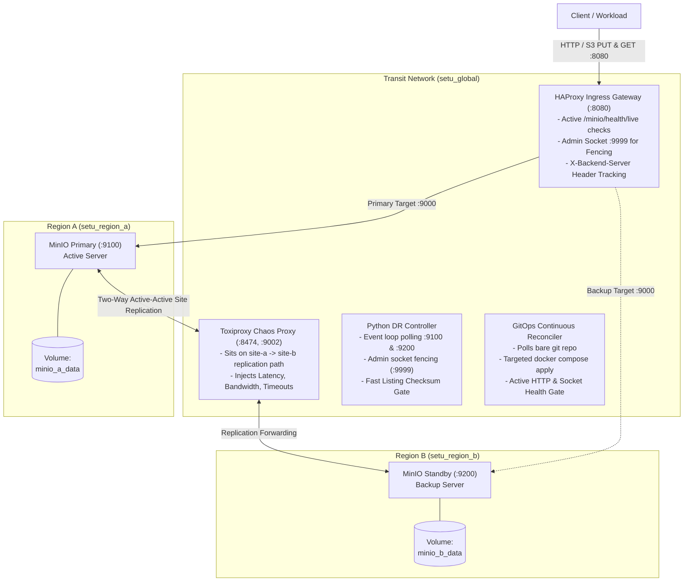
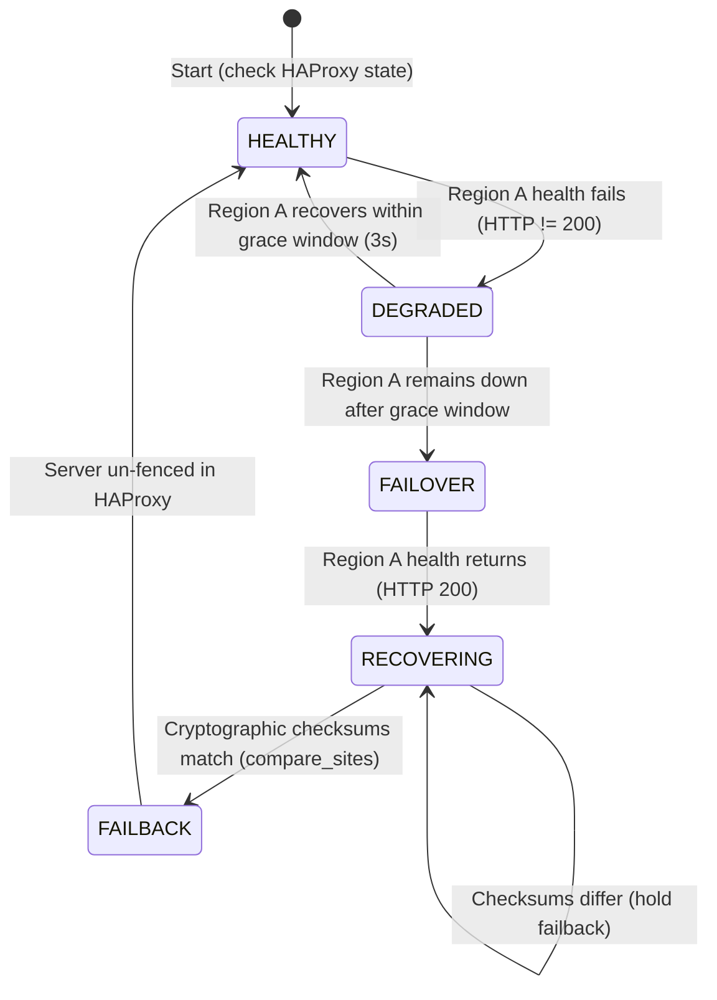

# System Architecture & Design Specification

## 1. Architectural Overview

The platform simulates a production-grade multi-region object storage platform hosted locally on a single Linux machine. It enforces physical-style regional boundaries using dedicated Docker networks and storage volumes, with all cross-region communication restricted to an isolated transit network.

---

## 2. Platform Components

### 2.1 Storage Layer: MinIO Site Replication
- **Container Base**: `cgr.dev/chainguard/minio@sha256:3c60a2a8c4d33409a9bc7a623a7fcbfb4605adc3d89422d2f53b3f673a6e5597` (RELEASE.2026-10-23).
- **Topology**: Two regions (`minio-a` on port 9100, `minio-b` on port 9200), each bound to its own Docker bridge network (`setu_region_a`, `setu_region_b`) and private persistent volume (`minio_a_data`, `minio_b_data`).
- **Replication Semantics**: Active-active site replication configured via `mc admin replicate add`. S3 PUT requests accepted on either site are recorded locally and asynchronously replicated to the remote site over the shared `setu_global` network.
- **Resource Constraints**: Capped at 512 MiB RAM each (`mem_limit: 512m`) to prevent exhausting the WSL/host environment.

### 2.2 Ingress Gateway: HAProxy Layer-7 Reverse Proxy
- **Container Base**: `haproxy@sha256:2caaf8b1a1ef67f3f1ea9b721f2821675d3ba4500fb518e23884fecb93e8dbaa` (3.4.7-alpine).
- **Ports**: `:8080` (HTTP Ingress), `127.0.0.1:9999` (UNIX/TCP Admin Socket).
- **Backend Configuration**:
  - `server minio-a minio-a:9000 check inter 1s fall 2 rise 2`
  - `server minio-b minio-b:9000 check inter 1s fall 2 rise 2 backup`
- **Observability**: Injects `http-response set-header X-Backend-Server %s` so clients can determine exactly which backend handled each write without inspecting backend storage.
- **Fencing Interface**: Exposes administrative socket allowing the DR controller to dynamically disable (`set server minio_api/minio-a state maint`) or enable servers at runtime without reloading HAProxy or dropping in-flight connections.

### 2.3 Disaster Recovery Controller (`controller/dr_controller.py`)
A standalone Python daemon built exclusively with the Python standard library (`socket`, `urllib`, `json`, `subprocess`). It implements a formal 5-state deterministic finite state machine (FSM).

- **FSM States**:
  1. `HEALTHY`: Normal operations. Region A primary, Region B standby backup.
  2. `DEGRADED`: Region A health probe fails. A 3-second grace window begins to suppress failover on transient network blips.
  3. `FAILOVER`: Grace window expires. The controller:
     - Disables `minio-a` in HAProxy (`state maint`), fencing it from receiving client traffic.
     - Executes an active S3 write probe to measure Recovery Time Objective (RTO).
     - Logs the transition and measured RTO as structured JSON.
  4. `RECOVERING`: Region A returns to live status. The controller refuses to fail back immediately. Instead, it enters an automated consistency gate polling `compare_sites()`.
  5. `FAILBACK`: Full site parity is cryptographically verified (`match: true`). The controller un-fences Region A (`enable server minio_api/minio-a`), restoring it to active primary.

### 2.4 Integrity Proof Engine (`controller/proof.py`)
- **Fast Metadata Path**: Executes `mc ls --recursive --json` across both sites in parallel. Diffs keys, sizes, and ETags. Clean data matches in **1.2 seconds** across 140+ objects (a 123x speedup over sequential downloads).
- **SHA-256 Fallback**: If an ETag differs due to multipart upload chunk boundaries, `compare_sites()` streams only the differing object to compute its SHA-256 digest. If hashes match, failback is allowed.
- **Deep Audit (`make audit`)**: Forces full payload retrieval and SHA-256 calculation for every object on both sites to detect silent bit rot.

### 2.5 GitOps Reconciler (`gitops/reconciler.py`)
- **Pattern**: Pull-based continuous reconciliation daemon running on a 1-second polling interval.
- **Isolation**: Operates inside a dedicated worktree (`/tmp/setu-gitops-wt`) tracking a bare git remote, leaving the developer repository clean.
- **Targeted Application**: Runs `git diff --name-only <last_good> <candidate>` to detect modified services. It recreates *only* the affected container (`docker compose up -d --no-deps --force-recreate <service>`), leaving storage containers untouched.
- **Active Health Gate**:
  - Pre-flight: `docker compose config` syntax validation.
  - Post-apply: HTTP probing on gateway (`:8080`) and backends, plus HAProxy socket validation.
- **Self-Healing Rollback**: If the health gate fails or times out (15s), the reconciler automatically checks out `last_good`, redeploys, verifies recovery, and appends the faulty commit hash to `.gitops_state.json` `bad_commits`.

### 2.6 Chaos Engineering Framework (`chaos/`)
- **Toxiproxy v2.9.0**: Sits specifically on the `minio-a` -> `minio-b` replication path (`:9002`). Controlled via REST API on `:8474`.
- **SigV4 Standard Library Client**: Generates AWS Signature Version 4 HMAC-SHA256 authenticated PUT requests using standard Python (`hashlib`, `hmac`, `urllib`), eliminating third-party dependencies.
- **Concurrent Writer**: Multi-threaded generator (4 threads, 60ms delay) generating sustained concurrent write streams (~35–45 req/s) with per-request latency, backend tracking via `X-Backend-Server`, and payload verification.

---

## 3. Data Flow Narratives

### 3.1 Normal Ingress Write Flow
1. Client issues authenticated S3 `PUT /bucket/key` to HAProxy gateway on port `8080`.
2. HAProxy inspects active health check status; `minio-a` is `UP`, so traffic routes to `minio-a:9000`.
3. HAProxy appends `X-Backend-Server: minio-a` to the HTTP response headers.
4. `minio-a` writes the object to volume `minio_a_data` and returns `200 OK` to HAProxy, which returns `200 OK` to the client.
5. In the background, MinIO site replication worker sends an asynchronous replication request across `setu_global` to `minio-b:9000` (or through Toxiproxy `:9002`).
6. `minio-b` persists the object to `minio_b_data`. Both regions now hold identical data.

### 3.2 Narrated Failure Story: Abrupt Primary Crash & Self-Healing Failback
The following sequence narrates the exact runtime events verified during Milestone M3 and M5 testing:

1. **Disaster Strike**: While concurrent client traffic is actively writing to the gateway at ~40 req/s, `minio-a` suffers an abrupt crash (SIGKILL).
2. **Detection & Failover**:
   - HAProxy's layer-7 health check (`GET /minio/health/live`) fails.
   - HAProxy automatically redispatches pending client requests to the backup server `minio-b`.
   - The DR controller detects `minio-a` health failure and enters `DEGRADED`.
   - When `minio-a` remains down after the 3-second grace window, the controller enters `FAILOVER`.
   - The controller sends `set server minio_api/minio-a state maint` to HAProxy's admin socket, locking `minio-a` in maintenance mode so it cannot receive traffic even if it reboots abruptly.
   - The controller executes a probe write through the gateway to confirm `minio-b` is accepting traffic, recording RTO (**3448 ms**).
3. **Region B Serves All Traffic**:
   - HAProxy routes 100% of incoming client traffic to `minio-b`. Responses return `X-Backend-Server: minio-b`.
   - All writes during this outage are persisted to `minio_b_data`.
4. **Primary Returns**:
   - `minio-a` is restarted (`docker compose start minio-a`).
   - The DR controller detects Region A is live and enters `RECOVERING`.
   - **Crucial Safety Gate**: The controller does *not* un-fence Region A. Region A remains in `MAINT`.
5. **Cryptographic Checksum Verification**:
   - The controller runs `compare_sites()`.
   - *Attempt 1*: `compare_sites()` reports `match: false` (objects written to Region B during the outage have not yet finished replicating to Region A). The controller holds in `RECOVERING`.
   - MinIO site replication automatically catches up across the global network.
   - *Attempt 2*: `compare_sites()` reports `match: true` (all 143+ objects match across both sites).
6. **Automatic Failback**:
   - The controller transitions from `RECOVERING` to `FAILBACK`.
   - It issues `set server minio_api/minio-a state ready` to the HAProxy admin socket.
   - HAProxy marks `minio-a` as `UP`. New client requests immediately route back to Region A as primary.
   - The controller returns to `HEALTHY`. The entire disaster recovery cycle completes without human intervention and with zero data loss.

---

## 4. Engineering Definitions

- **Recovery Time Objective (RTO)**: The elapsed wall-clock duration from the instant primary service availability is lost until the platform successfully acknowledges its first write on the backup region. In this platform, RTO includes the configured 3-second grace window (designed to filter transient flapping) plus the duration of the write probe.
- **Recovery Point Objective (RPO)**: The quantity of data lost during an unplanned disaster, measured as acknowledged client writes missing from the surviving backup site.
  - `RPO_failover`: The number of acknowledged client writes present on primary but missing on the standby backup at the exact moment of failover.
  - `RPO_after_return`: The number of acknowledged client writes permanently lost across the entire platform after primary recovers and replication synchronization completes.
- **Automated Failback**: The defensive restoration of primary traffic routing *only after* cryptographic proof confirms that all writes accepted by the standby region during the outage have fully synchronized back to the primary volume.

---

## 5. Mandatory System Limitations

The following limitations represent deliberate design trade-offs and physical realities of the local simulated architecture:

1. **Eventual Consistency & Last-Write-Wins (LWW)**: MinIO site replication is an active-active, eventually consistent system. In the event of an un-fenced network partition or simultaneous dual-primary writing, conflicts on identical object keys are resolved strictly by object timestamp (Last-Write-Wins). The losing version is overwritten; concurrent multi-master writes to the same key can result in silent data overwrite.
2. **RPO Measurement Scope**: The measured RPO of `0` missing objects was empirically validated under workloads of approximately 35–42 writes/sec with small objects (4 KB – 20 KB) and with **surviving disk volumes**. This is an empirical demonstration of replication performance under test conditions, not a mathematical zero-data-loss guarantee. Physical storage corruption or sudden disk wipe (catastrophic disk destruction) was not tested.
3. **RTO Includes Client Timeouts**: During gray failures (such as `docker pause` in E2), RTO measurements include the client HTTP request timeout (3.5 seconds) in addition to HAProxy's 2-second connection timeout and redispatch window, resulting in measured RTO clustering around ~7.2 seconds.
4. **Network Chaos Scope (Toxiproxy Placement)**: Toxiproxy is deployed specifically on the `minio-a` -> `minio-b` replication path (port 9002). In experiment E4 (asymmetric partition), timeout toxics explicitly cut traffic between `site-a` and `site-b`; client-to-gateway and client-to-direct-port paths remained unaffected. In experiment E3, replication lag variations between isolated and combined scenarios reflect connection pooling and measurement granularity; no artificial trend is claimed.
5. **Simulated Multi-Region Environment**: Both "regions" execute as Docker containers on a single host Linux kernel. Inter-region WAN characteristics (propagation delay, packet loss, bandwidth caps) were simulated programmatically via Toxiproxy rather than traversing actual cross-continental fiber.
